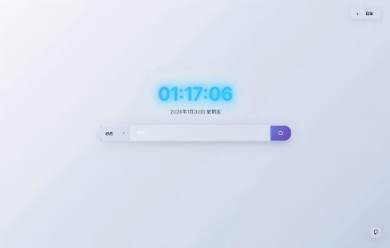
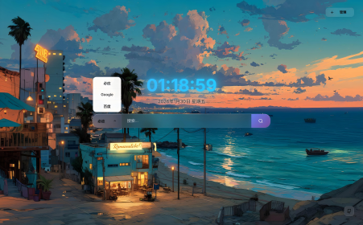

# 琪窦初开（QidoBloom）

Chrome / Edge 新标签页扩展。分组收纳常用网站，位置可直接拖动；搜索框切换引擎，壁纸自选图片。




## 功能

- 分组书签：常用网站按用途分组，组名与组的先后顺序均可调整
- 拖拽排序：支持组内换位与跨组移动，分组本身亦可拖动重排
- 搜索引擎：内置必应、Google、百度、GitHub，支持添加自定义引擎并设为默认
- 快捷收藏：通过扩展图标或页面右键菜单存入指定分组
- 待分组：未确定归属的网站暂存于此
- 壁纸：纯白背景、三张内置图片、本地上传、图片地址
- 图标缓存：网站图标按域名缓存在本地，离线打开照常显示
- 数据备份：导出为 JSON 文件，或同步至浏览器账号

## 安装

1. 下载项目压缩包，解压到本地任意目录
2. 打开 `chrome://extensions` 或 `edge://extensions`，开启页面右上角的「开发者模式」
3. 点击「加载已解压的扩展程序」，选择解压后的目录

## 使用

### 分组与网站

「管理 → 分组管理」用于维护全部分组与网站。

- 点击「添加分组」新建分组，填写名称
- 分组卡片上的「添加」用于新增网站，需填写名称与地址；图标地址可留空，留空时按图标源自动获取
- 每个分组可编辑名称、删除；每个网站可编辑名称与地址、删除
- 按住图标可拖到其他分组，也可拖入空分组
- 按住分组标题可调整分组先后顺序

### 搜索引擎

「管理 → 搜索引擎」列出当前全部引擎，可添加、编辑、删除。

搜索地址中以 `{q}` 表示关键词位置，例如：

```
https://www.baidu.com/s?wd={q}
```

起始页搜索框左侧显示当前引擎，点击可切换。所选引擎保存在本地，下次打开沿用。

### 壁纸

「管理 → 壁纸设置」提供四种来源：

- 纯白背景
- 三张内置图片
- 本地上传，支持 JPG、PNG、GIF
- 图片地址，填写后加入列表，点击切换

### 收藏网页

- **扩展图标**：点击工具栏图标弹出收藏面板，可修改名称、选择分组，或直接新建分组
- **右键菜单**：在页面上右键选择「把当前页面添加到『琪窦初开』」，在链接上右键选择「把这个链接添加到『琪窦初开』」，再从子菜单选择分组

两种方式均支持「先收进『待分组』」；目标分组不存在时，网站归入「待分组」。

通过右键菜单收藏后，扩展图标右上角显示尚未合并的数量，打开起始页即完成合并。

### 图标来源与缓存

默认图标源为：

```
https://toolb.cn/favicon/{domain}
```

「管理 → 图标来源」可替换为自己的地址，`{domain}` 为域名占位符。同一面板提供「清空缓存」。

图标按域名存入本地数据库，30 天后重新抓取。图标源取不到图片时显示网站名称首字母。

### 配置同步

「管理 → 配置同步」提供两种方式：

**导出与导入**

导出的 JSON 文件包含分组与网站、搜索引擎列表、当前引擎、壁纸地址、图标源。本地上传的壁纸图片体积较大，不写入配置文件。

**同步到浏览器账号**

「同步到账号」将配置写入浏览器账号的同步存储，同一账号登录的其他设备安装扩展后点「从账号恢复」即可取回。Chrome 与 Edge 的账号各自独立，不互通。

## 快捷键

- `Ctrl + K`：聚焦搜索框
- `Ctrl + F`：聚焦搜索框
- `Esc`：关闭已打开的面板

## 数据存储

- `startpage-data`：分组与网站
- `startpage-wallpaper`：壁纸设置
- `startpage-engine`：当前搜索引擎
- `searchEngines`：搜索引擎列表
- `startpage-faviconapi`：图标源地址

网站图标另存于 IndexedDB。卸载扩展会清除上述全部数据，卸载前请先导出配置。

## 目录结构

```
├── index.html          新标签页
├── style.css           起始页样式
├── script.js           起始页脚本
├── popup.html          收藏弹窗
├── popup.css           弹窗样式
├── popup.js            弹窗脚本
├── shared.js           起始页与弹窗共用的数据读写
├── icon-cache.js       图标缓存（IndexedDB）
├── background.js       后台脚本（右键菜单、角标）
├── manifest.json       扩展清单
├── landing/            产品介绍页
├── img/                内置壁纸
└── screenshot/         截图
```

## 权限

- `storage`：保存分组、壁纸与各项设置
- `contextMenus`：右键菜单收藏
- `activeTab`：读取当前页面的标题与地址
- `host_permissions`（全部网站）：按域名获取网站图标
